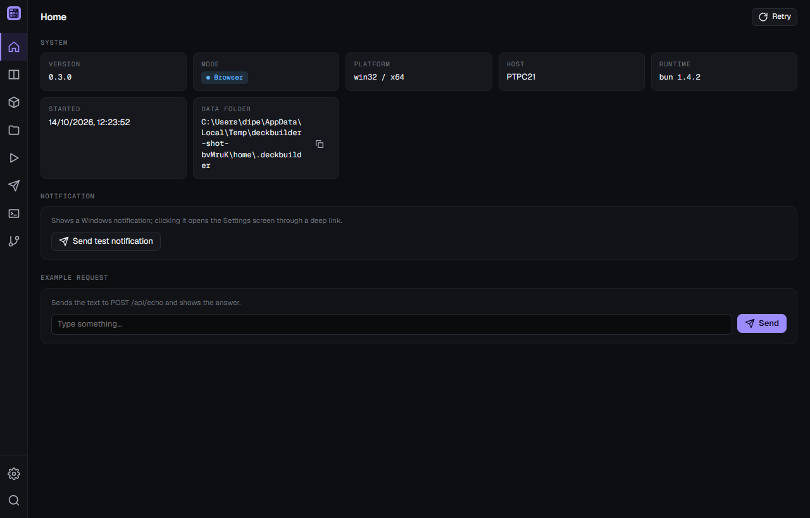
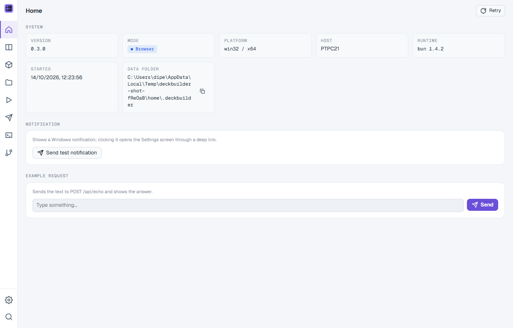
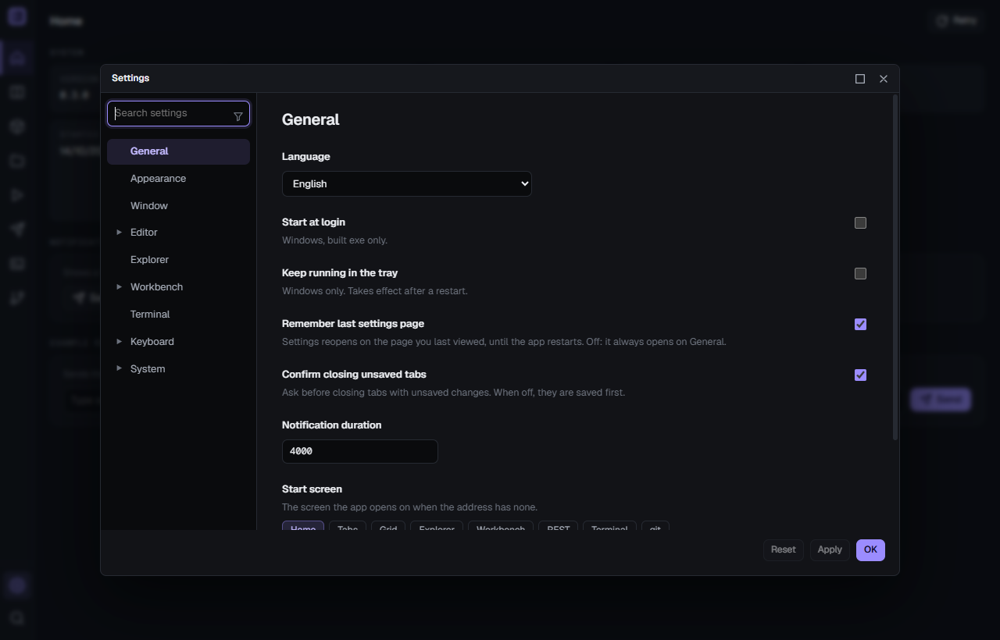
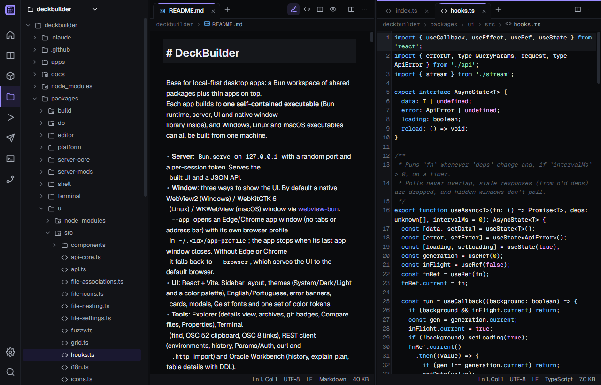
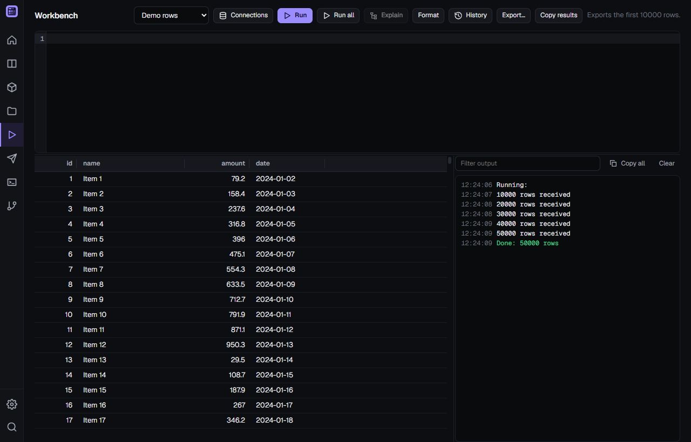
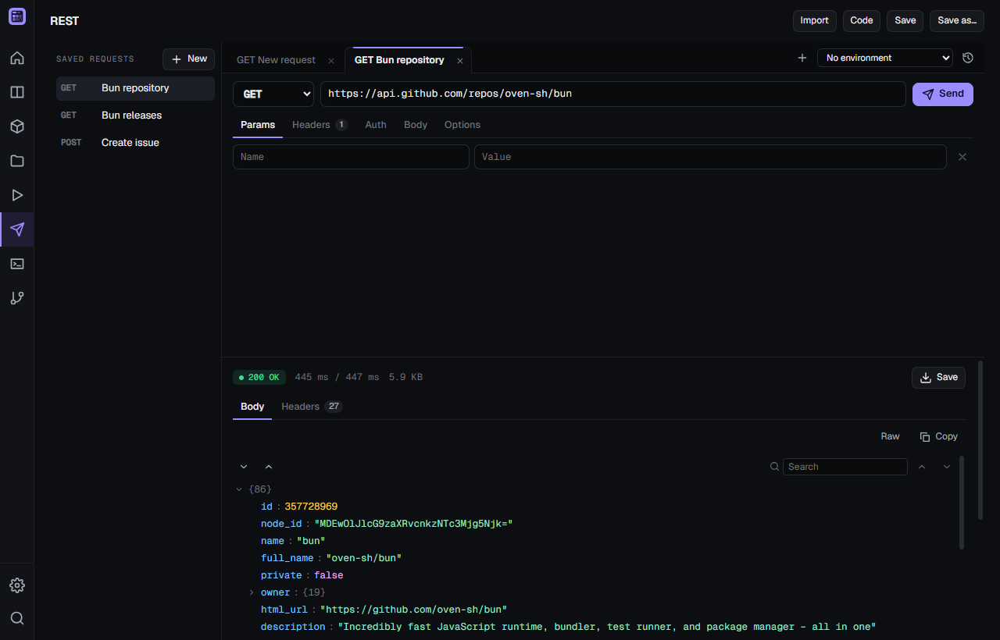
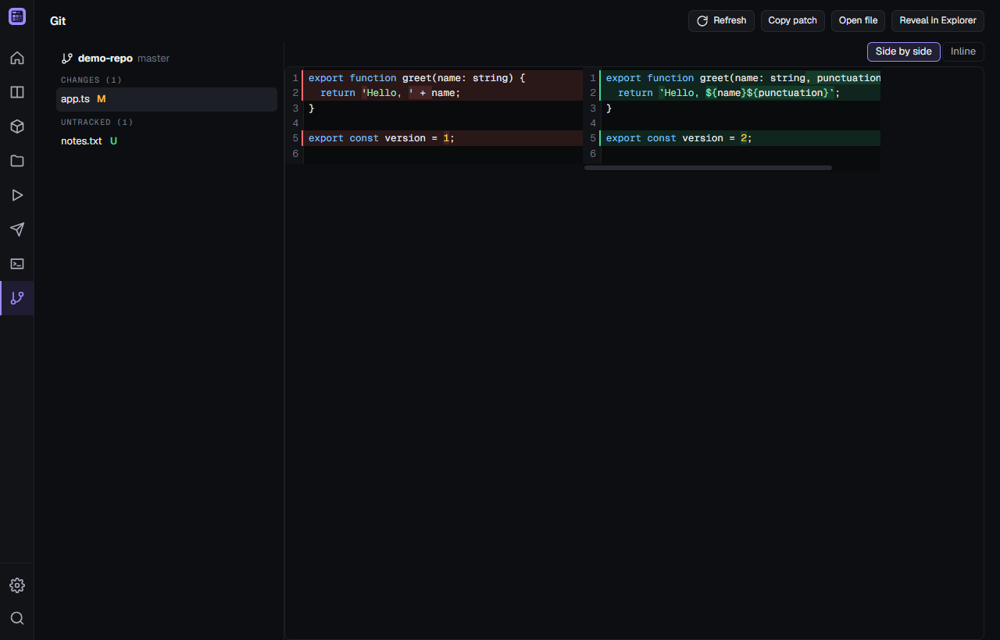

# DeckBuilder

Base for local-first desktop apps: a Bun workspace of shared packages plus thin apps on top. 
Each app builds to **one self-contained executable** (Bun runtime, server, UI and native window
library inside), and Windows, Linux and macOS executables can all be built from one machine.

- **Server**: `Bun.serve` on `127.0.0.1` with a random port and a per-session token. Serves the
  built UI and a JSON API.
- **Window**: three ways to show the UI. By default a native WebView2 (Windows) / WebKitGTK 6
  (Linux) / WKWebView (macOS) window via [webview-bun](https://github.com/tr1ckydev/webview-bun).
  `--app` opens an Edge/Chrome app window (no tabs or address bar) with its own browser profile
  in `~/.<id>/app-profile`; the app stops when its last app window closes. Without Edge or Chrome
  it falls back to `--browser`, which serves the UI to the default browser.
- **UI**: React + Vite. Sidebar layout, themes (System/Dark/Light and a color palette), English/Portuguese, error banners,
  cards, modals, Geist fonts and one set of color tokens.
- **Tools**: Explorer (details view, archives, git badges, Compare files, Properties), Terminal
  (find, OSC 52 clipboard, OSC 8 links), REST client (environments, history, Params/Auth, curl and
  `.http` import) and Oracle Workbench (history, explain plan, table details with DDL).
- Data and settings live in `~/.<app id>` (here `~/.deckbuilder`), outside the install folder.

## Screenshots









The Electron version of this project is in the git history (commit `585c282`); see
`docs/shell-decision.md` for why webview-bun replaced it.

## Requirements

[Bun](https://bun.sh) 1.3 or newer. `bun install` once at the root.

Window mode needs the OS web view: WebView2 is part of Windows 10/11; Linux needs WebKitGTK 6.0
(GTK 4): `sudo apt install libwebkitgtk-6.0-4` on Debian/Ubuntu.

## Scripts

Run at the root (they act on `apps/gallery`) or inside any app folder:

| Command | What it does |
|---|---|
| `bun run dev` | Hot reload: the server in watch mode on port 7420 plus Vite. Open the URL the server prints (`http://localhost:5173/?c=<code>`); it survives reloads, and a server restart prints a new one. |
| `bun run dev:window` | (in the app folder) The same, with a native window on the Vite URL (`bun run dev -- --app` for an app window). |
| `bun run start` | Run from source in a native window. Needs `build:web` first. `bun run start -- --app` for an app window. |
| `bun run start:browser` | Run from source in browser mode. Flags: `--port <n>`, `--no-open`. |
| `bun run build:web` | Bundle the UI into `apps/<app>/dist/web`. |
| `bun run build` | Build the UI, then the executable for this machine into `apps/<app>/release/`. |
| `bun run build --target all` | Executables for every target. Targets: `windows-x64`, `linux-x64`, `linux-arm64`, `darwin-x64`, `darwin-arm64`; comma-separate several. `--no-web` reuses the last UI build. |
| `bun run new <dir> [--name] [--id]` | (root) Create an app in `apps/<dir>` from the template, see [New app](#new-app). |
| `bun run typecheck` | Type-checks every package and app. |
| `bun test` | (root) Unit tests of the packages. |
| `bun scripts/screenshot.ts --out <png>` | (root) Screenshot of the gallery UI in headless Edge/Chrome, with its own `--dev` server on port 7799 and a temp home. Flags: `--hash <route>`, `--settings '<json>'` (seeds `settings.json`), `--seed '<json>'` (`{"<file>.json": value}` written beside it, e.g. `projects.json`), `--eval '<js>'`, `--size WxH`, `--wait <ms>`, `--no-build`. |
| `bun run deckbuilder release --to <folder>` | (in the app folder) Publish a release for the self-updater, see [Releases](#releases). |
| `bun run deckbuilder manifest` | (in the app folder) Write `release/latest.json` and its signature for the built exes, see [Releases](#releases). |
| `bun run deckbuilder keygen` | (in the app folder) Create the app's update signing key, see [Releases](#releases). |

The executable takes the same flags as the source: `--app` (Edge/Chrome app window),
`--browser` (Settings then has a Quit button that stops the app; wins over `--app`),
`--no-open`, `--port <n>`, `--open-url <uri>` (open a native window on a `<id>://open/<path>` link), `--dev` with `--window`, `--idle-exit <min>` (exit after that
many minutes without a request from an open UI; the UI sends a heartbeat every minute through
`useHeartbeat()`; never with `--dev`), `--help`.

Only one instance runs (except with `--dev`): the running one publishes its port in
`~/.<id>/instance.json`, with a secret that unlocks only `POST /api/instance/open`. A second
launch asks it to open a new window (an app window for `--app`, a browser tab for `--browser`)
and exits. Two launches at
the same moment are kept apart by `~/.<id>/instance.lock` (holds the pid of the launch that
starts the instance).

## Layout

```
packages/
  server-core/   Bun.serve server: host, Origin and token checks, launch codes, static files
                 with CSP, AppError, routes type; protocol.ts (token header, launch code
                 parameter, dev ports, error body) is shared with the UI
                 release.ts: latest.json manifest, signature check and version helpers
                 stream.ts: `ndjson` streaming responses
  server-mods/   Opt-in route modules: settings (GET/PUT /api/settings), info (GET /api/info),
                 update (self-updater + GET /api/update, POST /api/update/check|apply),
                 records (JSON-file record store + CRUD routes), rooted-fs (/api/fs/*),
                 dialogs (/api/dialog/*)
  shell/         runApp(): parses flags, single instance, starts the server, opens a window
                 (one Worker per window, Webview.run() blocks its thread), an app window or
                 the browser
  platform/      OS-specific code: open URL, find Edge/Chrome for app windows, app data folder, error message box, processes
                 (run with timeout, kill tree, start detached), exe swap for updates; json-file (atomic writes),
                 secrets (DPAPI), dialogs (native pickers), files (reveal, open), trash (recycle bin);
                 win/: toasts, tray, autostart (HKCU Run key), URL protocol, PowerShell helpers; theme.ts: osThemeKind
  ui/            React components (Sidebar, Badge, ErrorBanner, Modal, Icon, ...), hooks,
                 API client, i18n engine with the base messages, hash routing, styles.css
  editor/        CodeMirror 6 editor and content viewers (CodeEditor, CodeView, MarkdownView, FilePreview)
  db/            Opt-in Oracle access (oracledb thin mode): URL parser, sessions with explicit
                 transactions, /api/db/* routes
  terminal/      Opt-in integrated terminal: `TerminalPane` (xterm.js client view), protocol, and server
                 sessions (real PTY, screen replay, launchers, /api/terminal/* routes)
  build/         The `deckbuilder` CLI used by app scripts: dev, build:web, build, release; new
                 template/ is the app that `deckbuilder new` copies
apps/
  gallery/       Example app (Home, Tabs, Grid, Explorer, Workbench, REST, Terminal screens, Settings and Keyboard shortcuts modals, echo and toast endpoints)
    app.ts         Name and id
    server/        main.ts (composes routes, calls runApp) and routes.ts (the app's own API)
    web/           Vite root: index.html, public/favicon.svg (also the exe icon), src/
scripts/         Root scripts (typecheck, screenshot)
```

The base imposes no layout: an app picks the components it needs. Packages export TypeScript
source directly; there is no package build step.

### Adding things to an app

- **An endpoint**: add `'GET /api/thing': ({ query, json }) => ...` to `server/routes.ts`, then a
  method in `api` in `web/src/api.ts`. Throw `invalid(...)`/`notFound(...)` from
  `@deckbuilder/server-core` for errors the UI should show; add `error.<code>` to the app's i18n
  files to translate them.
- **A screen**: add its id to `SCREENS` and an entry to `NAV` and `renderScreen` in
  `web/src/App.tsx`, a file in `web/src/screens/`, and its labels to `web/src/i18n/en.ts` and
  `pt-BR.ts` (TypeScript fails until both have every key).
- **A setting**: extend `Settings` in `server/main.ts` and `web/src/api.ts`, give it a default,
  and validate it in the `apply` option of `settingsStore`; react to changes in `onChange`.
- **Themes**: `useTheme(settings)` (from `@deckbuilder/ui`) applies the palette of `ThemeSettings`
  (`theme`, `paletteDark`, `paletteLight`; palettes in `@deckbuilder/server-core/palettes`) to `<html>`.
  Make the app `Settings` extend `ThemeSettings` and render `<AppearanceFields value onChange />` in
  its settings. Style with the `var(--…)` tokens only. Pass
  `transformIndex: themeHead(settings)` (from `@deckbuilder/server-mods`) to `runApp`, so
  `index.html` already carries the saved palette and the first paint has its colours.
- **Keyboard shortcuts**: `useCommand(def, run, { enabled? })` (from `@deckbuilder/ui`) runs `run`
  on one of a `CommandDef`'s chords (`{ id, scope, label, keys, inInput?, inModal?, desktopOnly? }`;
  `scope` is `GLOBAL` or a screen id). Wrap the app in `<KeybindingProvider defs keymap scope>` to
  dispatch them from one listener: the current screen's (`scope`) commands win over global ones and
  a `Keymap` (`{ [id]: chords }`, `[]` unbinds) overrides the defaults; without a provider each
  command listens on its default keys. The pure model (`chordOf`, `normalizeChord`, `resolve`,
  `conflictsOf`, `validKeymap` for server-side settings validation) is in
  `@deckbuilder/ui/keybindings`. Package commands come from `paletteCommand()`,
  `tabCommands(scope)` and `explorerCommands(scope)`; list them in `defs`. Keys a focused widget
  handles itself (editor, tree and table navigation, dialogs) aren't commands.
- **Keybindings editor**: `<KeybindingsEditor defs keymap onChange scopeLabel />` (from
  `@deckbuilder/ui`) lists every command with its keys and edits them: change, add (up to 4) or
  remove a chord, reset one or all, filter, and "Find by shortcut" (press a chord to see what uses
  it). It refuses a chord another command uses in the same scope or in `global`. Feed it
  `useKeybindings()`'s `defs` and the settings' `keymap`, and save `onChange`'s result as
  `settings.keybindings` (the settings route validates it with `validKeymap`). The provider re-reads
  the keymap, so changes apply at once. See the gallery's and the template's `KeysModal.tsx`.
- **Settings and keybindings modals**: `<Modal title onClose large>` is VS Code's modal editor (80% of
  the window, up to 1400x900, maximize button). Settings (Ctrl+,) and Keyboard shortcuts (Ctrl+K Ctrl+S,
  or the link under the Settings sections) open in it over the current screen and close with Escape or
  a click outside; `#/settings` and `#/keys` links still open them. Settings rows follow VS Code's:
  bold label, description, then the control; a boolean is one checkbox labelled by its description;
  the search shows a result count and per-section counts. See `SettingsModal.tsx`.
- **File icons**: `fileIconOf(name)` → `{ icon, tone? }` and `folderIconOf(name, childFiles?)` (from
  `@deckbuilder/ui`) pick a built-in icon by extension or folder name (an unnamed folder of two or
  more files of one kind gets that kind's icon). `TreeView` takes `iconOf` and `iconToneOf`;
  `TabTitle` takes `icon` and `tone`. See the gallery's `ProjectTree.tsx`.
- **Icon-only main menu**: `<Sidebar collapsed>` shows only the icons (items keep their label and
  `hint` as tooltip); the app adds `nav-collapsed` to the `.app` element (narrow first column).
  See the gallery's `App.tsx`.
- **Command palette**: `useCommandPalette()` (Ctrl+Shift+P, F1) gives `{ open, setOpen }`; render
  `<CommandPalette items onClose />` (both from `@deckbuilder/ui`) with `PaletteItem`s
  `{ id, group, label, hint?, keywords?, run }`. `keywords[0]` doubles as a prefix that narrows
  to its group (`theme nord`). The gallery's `App.tsx` lists screens, themes and Quit.
- **Tab workspace**: `<TabWorkspace layout onChange renderTab titleOf newRoute scope />` (from
  `@deckbuilder/ui`) shows tabs in up to 4 panes: open, close (also middle-click), reorder,
  drag between panes, Back/Forward per tab (shown once a tab has history). Each tab bar has a
  Split button (Alt+click splits down; both also in its "…" menu with Close pane;
  `splitPane(layout, tabId, 'right' | 'down')`), so panes nest (a pane beside a column of two)
  with draggable dividers (`resizeSplit`); closing a pane gives its space to its neighbours.
  `layout` is a `Layout<R>` for your route type `R` (`singlePane(newTab(route))` to start); its
  optional `tree` holds the arrangement (`layoutTree(layout)`; without it, one row of panes).
  Every tab stays mounted, so hidden ones keep their state, except when its pane moves under
  another split (splitting a pane of a split in the other direction): that pane remounts.
  `renderTab` gets `navigate(route)` to change what the tab shows, and `setActions(TabAction[])`
  to put the tab's actions in the bar (`primary`: icon buttons, `menu`: the "…" menu). Alt+1..9 select a
  tab; Ctrl+T, Ctrl+W and Ctrl+Tab only in the native window (browsers keep them); these are
  `tabCommands(scope)`, `scope` being the screen id. Persist with
  `serialize(layout)` and read back with `restore(raw, isRoute)`; the gallery's Tabs screen keeps
  it in the `tabsLayout` setting.
- **Panel grid**: `<PanelGrid items defs render onChange />` (from `@deckbuilder/ui`) shows draggable,
  resizable panels in a 12-column grid (6 and 1 column on narrower windows). `defs` are `PanelDef`s
  `{ id, title, icon, defaultSize, minW, minH }`, `items` the `GridItem`s `{ id, x, y, w, h, collapsed? }`;
  `render(id)` returns a panel's content, the grid adds the frame (drag by the header, collapse,
  remove). Only the full-width layout is editable and reported through `onChange`; keep it in a
  setting through `useDebouncedSave`, validated on the server with `validGridItems(raw, ids)` from
  `@deckbuilder/ui/grid` (no React; the gallery's `gridLayout`), and bring a removed panel back
  with `addItem(items, def)`. Inside a panel, `PanelLoading`, `PanelNotice` and `PanelBanner`
  show loading, empty/error and offline states. `PanelFrame` also works on its own (its `menu`
  prop adds a "…" button with `ContextMenuItem`s). Panels resize from both bottom corners. Each
  panel's menu offers Rename (1–40 characters) and Change icon, stored as `title` and `icon` on
  the `GridItem` (`icon` must be a built-in icon name); `IconPicker({ value, onPick, onClose })`
  is the searchable picker over the built-in set and works on its own. Instead of autosaving, the
  gallery's Grid screen keeps a working layout next to the saved one: Save writes the setting,
  Reset returns to the saved layout, Restore default loads the factory one (`sameItems(a, b)`
  drives the unsaved dot); unsaved changes survive switching screens, not a restart.
- **Explorer layout**: `<SplitView direction sizes onResize>` (resizable panes, persist `sizes` with
  `useDebouncedSave`), `<TreeView>` (lazy tree with keyboard, drag and rename), `<ContextMenu>` and
  `<Explorer scope>` (sidebar plus tab workspace; Ctrl+B, `explorerCommands(scope)`, folds the
  sidebar). The gallery's Explorer screen puts them together: the sidebar shows one project tree
  at a time (`TreePane`: a `ProjectPicker` header to switch, add, edit and remove projects, then
  the tree), a split-down button adds a second tree below with its own picker and a resizable
  divider (`trees` and `treeSizes` in the `explorer` setting), and Ctrl+Shift+F
  (`explorer.search`) replaces the body of the tree you last clicked with a `ProjectSearch`
  panel (names, or names and content, over `/api/fs/search`); Escape cancels a running search,
  then closes the panel.
  VS Code-style file management comes with it: preview tabs, dirty dots and close commands in the
  tab bar (`TabWorkspace`), a status bar and toasts (`StatusBar`, `ToastProvider`), breadcrumbs,
  undo, copy/cut/paste and drag and drop inside the tree and from and to the OS, compact folders,
  file nesting, exclude patterns and sort orders (Settings → Explorer; the Settings search filters every row). **Quick Open**: Ctrl+P
  lists the files of the shown projects ranked by `fuzzyPath` (recent files first, matched letters
  bold, Ctrl+Enter opens to the side); typing `>` switches the same box to commands, Ctrl+Shift+P and
  F1 open it on commands. An app offers its file list with `useProvideQuickOpen`; without
  one the box lists commands only. The list comes from `GET /api/fs/names` (every path, excludes
  applied). **Find in the tree**: Ctrl+F (`explorer.find`) opens a find box over the tree you
  last clicked; matches are highlighted and folders show match counts, the Filter chip hides
  everything else (and lists matches in folders never opened); Enter steps through the matches.
  **Maximize pane**: Ctrl+K Ctrl+M, a double-click on a non-preview tab or the "…" menu hide the
  tree and the other panes (they stay mounted; `TabWorkspace`'s `onMaximizedChange`, `Explorer`'s
  `hidden`). **Zen mode**: Ctrl+K Z (`explorer.zen`) also hides the nav and the status bars; Esc
  twice leaves. An empty tab lists the main shortcuts from the keymap.
- **A terminal**: add `@deckbuilder/terminal` (and `"lib": ["ESNext", "DOM", "DOM.Iterable", "DOM.AsyncIterable"]`
  in the app's tsconfig). Server: spread `terminalRoutes({ sessions, shell, resolveCwd, launchers })`
  (from `@deckbuilder/terminal/server`, `sessions = terminalSessions()`) into `routes`, and pass
  `sockets` and `onQuit: sessions.closeAll` to `runApp`; keep the shell in a setting
  (`terminal.shell`, checked with `isShellId`). Client: `<TerminalPane session cwd onSession />` in a
  tab, saving the id from `onSession` in the tab's route. Sessions survive socket drops and
  reloads (the screen is replayed on reattach); close them explicitly with `closeSession(id)` when
  the tab closes. `launchers` start other programs by id (the client sends an id and args, never a
  program; `parse` validates the args). `preview` viewers and `listSessions()` info (title, bells,
  `lastOutputAt`, `meta`) feed a session sidebar. Terminal-first keys: the pane owns the keyboard
  and only `appKeys` commands (the palette by default) pass through, by the first step of their chords (a gallery terminal passes Ctrl+K on to the app, not to the shell). A real PTY on every platform
  through `Bun.spawn({ terminal })` (ConPTY on Windows). The gallery's Terminal screen and the
  Explorer's "Open terminal here" use it.
- **Dialogs**: `useDialogs()` (from `@deckbuilder/ui`) gives `confirm` and `prompt` modals.
  Native pickers: `dialogRoutes()` on the server and the `dialogs` client in the UI (`pickFolder`,
  `pickFile`, `saveFileAs`). A route that takes back a path the client got from a dialog must
  check it with `pickedPaths().take` (pass the set to `dialogRoutes({ picked })`), so a client
  can't hand in any other absolute path. Tested on Windows; other systems are best-effort.
- **DataTable**: `<DataTable columns rows rowKey />` windows its rows (fixed row height), sorts,
  resizes columns (`widths` + `onWidthsChange` to persist), selects and copies. `toCsv` and `toTsv`
  build exports. `groupOf(row)` keeps rows of a lower group first whatever the sort (folders before
  files; `sortRows(rows, value, dir, group?)` does the same) and `onKeyDown` handles keys on the
  table; the Explorer's details view uses both.
- **Editor and viewers**: add `@deckbuilder/editor` to the app. `CodeEditor` (Ctrl+Enter runs
  `onRun`), `CodeView`, `MarkdownView`, `JsonTree` (from `@deckbuilder/ui`) and `FilePreview`
  (picks a viewer by file name: markdown, JSON tree, log, highlighted code, CSV/TSV table,
  Jupyter notebook, HAR, `.env`, image, SVG, audio/video, PDF, archive, SQLite, font, else hex
  for binaries; PDF, SVG and font viewers load lazily). The gallery's `FileTab.tsx` shows how
  each kind gets its content from `/api/fs/*`. `MarkdownEditor` (`value`, `onChange`, `mode`: `'live' | 'edit' | 'split' |
  'preview'`, `layout?`: `'left' | 'center' | 'full'`, `resolveImage?`) edits markdown in place (`live`: formatted inline, raw syntax
  only on the cursor's lines) or as source (`edit`), source + preview (`split`) or preview only;
  the host shows the mode switch (the gallery puts it in the tab bar) and keeps the layout with
  `useMarkdownLayout()`; in `split` the preview follows the editor's scroll proportionally and
  renders a deferred copy of the text, so typing stays smooth; `wrap` (default on) wraps long lines,
  like `CodeEditor`'s `wrap` (default off). Keep the mode in a setting. It brings the CodeMirror language parsers (~700 kB): load the
  screen with `React.lazy` and set `chunkSizeWarningLimit: 900` in `vite.config.ts`, as the gallery does.
- **File associations**: `setFileAssociations(list)` (from `@deckbuilder/ui`) makes files whose
  name matches a glob (`*`, `?`, case-insensitive) open and get icons as another extension, e.g.
  `{ pattern: '*.out', as: 'log' }`; `effectiveName(name)` applies it. Keep the list in a setting
  validated with `validFileAssociations` (`@deckbuilder/ui/file-associations`). The gallery's
  Settings have a File types section.
- **Streaming**: `ndjson(req, async (emit, signal) => ...)` in a route streams items without
  buffering; `useStream().start(path, params)` reads them into state (`cancel()` aborts) and
  `<OutputPanel lines />` shows log lines. See `GET /api/demo/rows` and the Workbench screen.
- **Records**: `recordStore({ dir, name, validate })` keeps items in a JSON file, and
  `recordRoutes(store, '/api/things')` exposes list/get/create/update/delete. In the UI,
  `ResourceList` and `ResourceForm` edit them. `secretFields: ['token']` with `secrets: secretStore(APP.id)`
  moves those fields into the secret store; the UI only sees `{ hasSecret: true }` and server code reads the
  value with `store.secret(id, 'token')`.
- **REST client**: `httpExecutor()` and `httpRoutes(executor, { secretHeaders })` (from
  `@deckbuilder/server-mods`) serve `POST /api/http/send` and `/api/http/save`; the UI is
  `RequestEditor` and `ResponseView` from `@deckbuilder/editor` (pure helpers in
  `@deckbuilder/editor/http`). `secretHeaders(ref, url)` returns headers to add from a stored
  secret (the gallery sends a saved Authorization only to the origin it was saved with).
  `validateDraft(raw)` checks a saved `HttpRequestDraft` (call it in the store's `validate`); the
  limits it shares with the send route and the editor are the `HTTP_*` constants in
  `@deckbuilder/server-core/protocol`. Limits: 10 MB response body, 60 s default timeout,
  http/https URLs only. See the REST screen.
  Import: `parseCurl(text)` (browser "Copy as cURL", bash and cmd forms) and `parseHttpFile(text)`
  (VS Code REST Client / IntelliJ `.http`: `###`, `@var`/`{{var}}`, `# @name`) from
  `@deckbuilder/editor` return `ImportedRequest`s: `{ name?, draft, auth?, warnings }`, with the
  Authorization value taken out of the headers into `auth` (the secret field) and `warnings` as
  `<code>:<argument>` strings to translate; `parseImport(text)` picks cURL or `.http`. A file
  import is a route that shows `pickFile` on the server and returns only `{ name, text }`, never
  the path (`POST /api/requests/import-file`, 1 MB at most); the client parses and saves.
  `RequestEditor` has Params and Auth tabs and form and multipart bodies; the draft round-trips
  to curl and `.http`. Environments: `variableResolver(vars)` (`rest-env.ts`) resolves `{{name}}`
  on every send; `httpRoutes` options `environmentVars(id)` (variables of the request's
  `environment`) and `onSend(entry)` (history). An unknown `{{x}}` fails with `unknownVariable`.
  The gallery serves `/api/rest/environments` and `/api/rest/history` (`rest/HistoryPanel.tsx`).
- **Rooted file system**: `rootedFs({ roots })` serves `/api/fs/*` (list, read, write, create,
  rename, move, delete, search; `raw` for binary content, with `limit=<bytes>` for the first
  bytes only; `sqlite` for a read-only page of 200 rows of a table). Requests carry a root id and a relative path, never an absolute
  path; deletes go to the recycle bin and a root can be `readOnly`. A link is never followed out
  of its root, but a path swapped between the check and the use (TOCTOU) is not guarded against.
  Archives: `POST /api/fs/extract {root,path,to}` and `POST /api/fs/compress {root,paths,name,format}`
  (`FsExtractRequest`, `FsCompressRequest` in `@deckbuilder/server-core/protocol`) run 7z-wasm in
  `archive-worker.ts`, which `packages/build/src/build.ts` ships as an extra entrypoint of the exe.
  Properties: `GET /api/fs/info|du|hash` (the gallery's Properties dialog).
- **Git (read-only)**: `gitRoutes(opts)` (from `@deckbuilder/server-mods`, `git.ts`) serves
  `GET /api/git/repos|status|file|diff`; the types (`GitStatus` and others) are in
  `@deckbuilder/server-core/protocol`. The gallery uses it for Explorer git badges (setting
  `git.explorerDecorations`: coloured files, status letters, a dot on folders with changes) and
  Compare files. `<DiffView original modified lang mode onModeChange modeLabels ref />` (from
  `@deckbuilder/editor`) shows a split or inline diff; `ref` has `next()` / `prev()` (F7 / Shift+F7).
- **Secrets**: `secretStore(appId)` (from `@deckbuilder/platform`) encrypts values with the Windows
  user's DPAPI key; pass it as `secrets` to a `recordStore`. Routes must return `hasSecret`, never the value.
  Tested on Windows only.
- **Opening files**: `revealInFolder` and `openWithDefault` (from `@deckbuilder/platform`); the
  latter opens only documents, images and media (`isOpenable`), never programs or scripts.
- **Startup work** (timers, update checks): put it in `runApp`'s `onStart`, which a launch that
  hands off to a running instance never reaches.
- **Notifications** (Windows): `createToaster()` from `@deckbuilder/platform`, then
  `toaster.show({ title, body, launch })`; a click opens `launch`. Use `ctx.link(path)` (the
  context `onStart` and `routes(ctx)` get) as `launch`, so the click opens the app on `#<path>`. Test with
  `bun packages/platform/src/win/toast.ts --selftest`.
- **Deep links** (Windows): `urlProtocol: true` in `runApp` registers `<id>://` for the exe at
  startup (the app id must be a valid URL scheme); `<id>://open/<path>` then opens a native
  window on `#<path>`, through the running instance when there is one. Windows starts the exe
  with `--open-url <uri>`. Remove the registration with
  `reg delete HKCU\Software\Classes\<id> /f`.
- **Tray** (Windows): `tray: true` in `runApp` shows the exe's icon in the notification area
  (a generic icon from source; none with `--dev`), with "Open <name>" (also on double-click)
  and "Quit". Closing the last window then keeps the app running, and it exits when idle only
  with `--idle-exit`. Pass `tray: { openLabel, quitLabel, items: [{ id, label, run }] }` for
  other labels and more entries between those two (ids must not start with `__`). The gallery
  reads it from a setting at startup, so a change takes effect after a restart. Test with
  `bun packages/platform/src/win/tray.ts --selftest`.
- **Log viewer**: `<LogView lines highlights onHighlightsChange ... />` (from `@deckbuilder/ui`)
  shows log lines with level colours and counts, search (case, whole word, regex), find-this-word
  on double-click and highlight chips; with `follow`/`bookmarks` props it also follows the end and
  keeps bookmarks. `useLogTail(fetchChunk, { key })` polls `GET /api/fs/tail` (from
  `rootedFs`) into `lines`; `POST /api/fs/save-range` writes everything after a byte offset
  to a file picked in the save dialog. A bookmark is a byte offset, so it goes stale when the file
  is rotated or cleared (shown as stale; copy and save answer `rangeStale`) and does not follow a
  rename. The gallery's `LogTab` (Explorer, `.log` files) persists highlights and bookmarks in
  the `logs` setting, capped and validated by `validLogSettings` (`@deckbuilder/ui/log`, with `LogSettings` and the
  `MAX_*` limits): it drops invalid entries instead of rejecting the whole value, so a client that
  passes its state through it holds what the server saves.
- **Open in editor**: `editorRoutes({ dir, fs })` (from `@deckbuilder/server-mods`, with a `rootedFs`)
  serves `/api/editors` (list, pick, override, open) for VS Code and IntelliJ IDEA. `findEditor`
  (platform) detects the real `.exe` (`code.cmd` on PATH leads to `Code.exe`; IntelliJ comes from the
  Toolbox script or the install folders); `openInEditor` opens the project folder, plus a file and
  line. The client never sends a program: it comes from detection or from an override chosen in a
  server-side file dialog (saved in `editors.json`). `.cmd` scripts are refused because they would
  go through `cmd.exe`, which interprets `&`, `%` and `^` in a project path. The gallery adds the
  entries to the Explorer's context menu and an External editors section to Settings.
- **Backup**: `backupRoutes({ app, settings, stores, excludeSettings })` (from `@deckbuilder/server-mods`)
  serves `/api/backup/*`: export writes the settings and the chosen record stores to a file picked
  in the save dialog; inspect reads a file picked in the open dialog (other app ids and malformed
  files are refused) and keeps it under a one-shot token for 10 minutes; import applies the chosen
  parts. The file is JSON: `{ format: 'deckbuilder-backup', version: 1, app, appVersion, exportedAt,
  settings?, records?: { <store>: Rec[] } }`. Settings go through `settings.save`, so its validation
  drops unknown fields; records go through `store.importItems(items, 'merge' | 'replace')`, which
  runs `validate` (with `ctx.imported`) per item and reports skipped ones with their error code.
  Secret fields are never exported and imports never change them: the user enters them again.
  Leave machine-specific settings out with `excludeSettings` (the gallery excludes `autostart`
  and `updateFolder`). The gallery's Settings have a Backup section.
- **Oracle database**: `@deckbuilder/db` (opt-in; add `"@deckbuilder/db": "workspace:*"` to the
  app, since it bundles the `oracledb` driver in thin mode: pure JS, no Instant Client). The app
  keeps the connections in a `recordStore` with `validate: validConnection` and
  `secretFields: ['password']`, and wires `dbRoutes({ sessions: dbSessions(), credentials })`,
  where `credentials(id)` reads the record, turns its `url` into a connect string with
  `parseOracleUrl(url).connectString` and adds `secret(id, 'password')` (null for an unknown id).
  Accepted URLs: `jdbc:oracle:thin:@host:port/service`, `oracle:thin:@host:port/service`,
  `@//host:port/service`, `host:port/service` (port 1521 when left out in the last two) and the
  SID form `oracle:thin:@host:port:SID`; descriptors and TNS aliases are refused (`badDbUrl`).
  Routes: `POST /api/db/connect {id}` → `{ connected, pending, busy }`; `POST /api/db/run
  {id, sql}` runs one statement (a trailing `;` and a `/` line are dropped, PL/SQL keeps its `;`)
  and returns `{ kind: 'rows', run, columns: [{ name, type }] }` for a query, then
  `GET /api/db/rows?run=` streams the rows as NDJSON arrays (`useStream`; at most 100 000, then
  `{ $truncated: true }`); other statements return `{ kind: 'done', rowsAffected? }`.
  `run` takes an optional `maxRows` (1 to 100 000, never above the sessions' limit): the stream
  ends after that many rows with `{ $truncated: true }` when there are more.
  `GET /api/db/schema?id=&owner=` lists the tables, views and columns of a schema owner (default:
  the session's current schema) plus the owners to choose from, for a schema browser and SQL
  completion (`CodeEditor` `sqlDialect="plsql"` + `sqlSchema`).
  `POST /api/db/commit|rollback|disconnect {id}` and `GET /api/db/status?id=` report the status.
  Transactions are explicit: nothing autocommits, DML and PL/SQL blocks set `pending`, DDL
  clears it (Oracle commits it), and disconnecting or 15 minutes without a call rolls back. One
  session per connection, one statement at a time (`dbBusy`); changing a connection's URL, user
  or password reconnects, refused with `dbPendingChanges` while changes are pending. Numbers
  arrive as strings (precision), dates as ISO text, binary values as `<binary n bytes>`. Driver
  errors become `dbLogin`, `dbUnreachable` or `dbError` (the first line, full text in `detail`),
  with the password replaced by `***`. Call `sessions.close(id)` when a connection record is
  deleted (a process that exits drops its sessions and Oracle rolls them back).
  The gallery's Workbench is the example: `server/routes.ts` keeps the `dbConnections` store
  (also in the backup, without passwords) and spreads `dbRoutes`; the Source select picks Demo
  rows or a connection, "Connections…" opens `workbench/Connections.tsx` (`ResourceList` +
  `ResourceForm`, password shown as "Saved", Test button), and while a connection is the source a
  bar shows an "Uncommitted changes" badge with Commit, Rollback and Disconnect; a "Max rows" field (default 1000, kept in the settings) limits each query, and
  the Schema button opens a sidebar with the tables and columns whose names also feed completion.
  SQL history: `dbRoutes({ ..., history: sqlHistory({ dir, max }) })` (`sqlHistory` from
  `@deckbuilder/db`, `history.ts`) records every run and serves `GET /api/db/history` and
  `POST /api/db/history/delete|clear`; the Workbench shows it in `workbench/HistoryPanel.tsx`.
  `POST /api/db/explain {id, sql}` returns the plan rows (not recorded in the history) and
  `GET /api/db/table` the details of a table, with its DDL.

## New app

```sh
bun run new <dir> [--name "<Name>"] [--id <id>]
bun install
cd apps/<dir> && bun run dev
```

Creates `apps/<dir>` from `packages/build/template/` (Home + Settings with Appearance, Updates,
autostart and tray; no demos). `<dir>` is lowercase letters, digits and dashes; `--name` is the
display name (default: the folder, capitalised); `--id` is the data folder `~/.<id>` and the URL
scheme for deep links (default: the folder without dashes). Then:

1. Replace `web/public/favicon.svg`; it is also the exe icon. Update `BrandMark` in
   `packages/ui/src/components/ui.tsx` if the brand should change for every app.
2. Add the app's endpoints in `server/routes.ts` and its screens under `web/src/screens/`.

## Releases

The version comes from the app's `package.json`. Executables are named
`<Name>-<version>-<win|linux|mac>-<arch>[.exe]`.

**Locally**: bump `version`, then `bun run build --target all` in the app folder.

**Signing key** (once per app): in the app folder, `bun run deckbuilder keygen` creates an
Ed25519 key pair. The private key goes to `~/.deckbuilder-keys/<app id>.pem`, outside the repo:
back it up, because losing it means a new key and every user reinstalling by hand
(`--force` replaces it). The public key goes to `update-key.pub` in the app folder: commit it;
`build` embeds it in the exe (from source the server reads the file). `release` and `manifest`
sign the exact bytes of `latest.json` into `latest.json.sig` and refuse to run without a key
(`--unsigned` skips the signature with a warning). The updater checks the signature before it
reads the manifest: a missing or wrong one is an error and offers nothing, and a build without
`update-key.pub` never updates. Exes built before signing ignore the `.sig`, so they accept the
first signed release. CI reads the key from the `DECKBUILDER_SIGNING_KEY` secret (the PEM
content).

**For the self-updater** (a shared folder, e.g. a UNC share): in the app folder,

```sh
bun run deckbuilder release --to '\\server\share\releases' [--bump patch|minor|major] [--target <list>]
```

bumps the version, runs typecheck and tests (`--no-checks` skips them), builds this machine's
exe (or `--target`), copies it with `latest.json` to `<folder>/<app name>/`, then commits the
bump and tags `<app folder>-v<version>` locally; it never pushes. `--dry-run` publishes the
same files but leaves `package.json` and git as they were. Users pick the folder (the root or
the `<app name>` subfolder) with Browse under Settings › Updates. The app checks at start and every 6 h
(30 min after a failure); applying copies the exe next to the running one, verifies its
SHA-256, renames the running exe to `<name>.old.exe` (Windows allows renaming a running exe,
not replacing it), moves the new one in place, starts it with `--after-update` plus the same
flags, and quits. The new exe deletes the old one once that has exited. The exe keeps its file
name, so the WebView2 profile survives updates. A UNC update folder still makes an SMB
connection to that server at every check (and Windows may offer it your NTLM credentials); the
signature protects the update, not that connection.

**Through GitHub Actions**: push a tag `<app folder>-v<version>`, e.g.

```sh
git tag gallery-v0.1.1 && git push origin gallery-v0.1.1
```

`.github/workflows/release.yml` checks the tag against `package.json`, builds every target on
a Windows runner, writes `latest.json` and `latest.json.sig` with `deckbuilder manifest`
(SHA-256 per exe, notes from the commits since the previous tag; needs the
`DECKBUILDER_SIGNING_KEY` repository secret) and uploads everything to a **draft** release; check the
files and publish it.

**GitHub releases as update source**: set `repo: 'owner/name'` in the app's `app.ts`
(`AppIdentity.repo`) and build the app's server with `githubSource({ repo, tagPrefix })` from
`@deckbuilder/server-mods` (the gallery does this when no update folder is set). The updater
takes the newest published release whose tag starts with `<app folder>-v`, reads its
`latest.json` and `latest.json.sig` assets and downloads the exe asset; `token` gives access to a private repo.
`deckbuilder manifest` (in the app folder, after `build`) writes `release/latest.json` and its
`.sig` by hand.
`.github/workflows/ci.yml` type-checks, runs the tests and builds a Linux executable for every
push and pull request.

### Platform notes

- **Windows**: the exe has no console window, so `--browser` mode from the exe runs in the
  background with nothing to close: stop it with the Quit button in Settings, or let it end by
  itself 10 minutes after the last tab closes (idle exit; not when the app has a tray icon,
  whose menu has Quit).
  WebView2 keeps its profile in `%APPDATA%\<exe file name>\`. The webview library passes that
  folder itself, so `WEBVIEW2_USER_DATA_FOLDER` has no effect, and a renamed exe
  starts with a fresh profile. App state belongs on the server (`~/.<id>`), not in
  `localStorage`. Unsigned executables trigger SmartScreen on first run ("More info" → "Run
  anyway").
- **Linux**: `chmod +x` the file. Window mode needs WebKitGTK (see Requirements).
- **macOS**: the output is a plain executable, not an `.app` bundle, and it is unsigned:
  `xattr -d com.apple.quarantine <file>` after downloading. Not tested on a Mac yet.

## Security model

The server binds to `127.0.0.1` only. Every `/api` call needs the random token generated at
start, sent in the `x-deckbuilder-token` header only; a token in the URL is ignored. The token
never appears in a URL, because URLs land in browser history, command lines and terminal output.
A terminal WebSocket can't send headers, so it takes a one-time, short-lived ticket in `?t=`
(issued by `POST /api/terminal/open|attach`, which need the token) and still passes the Host and Origin checks.

- **Launch codes**: every URL the app opens or prints carries a one-time code (`?c=<code>`)
  instead. The UI removes it from the address bar at once and trades it for the token at
  `POST /api/session`, then keeps the token in `sessionStorage`. A code works once and expires
  after 60 s, so a leaked URL is useless ("This link was already used"). In `--dev` the code is
  reusable for the server's lifetime, so the printed URL survives reloads.
- **Origin check**: a request with an `Origin` header must come from the app's own address
  (`127.0.0.1`, `localhost` or `[::1]` on its port; in `--dev` also Vite's), else 403. Requests
  whose `Host` header is not a loopback name are rejected, which blocks DNS rebinding.
- **CSP**: `index.html` is served with a Content-Security-Policy that allows scripts, fonts and
  API calls from the app only, inline styles, images from the app or `data:`/`blob:` URLs, and
  audio/video from the app or `blob:` URLs.
  Every static file gets `X-Content-Type-Options: nosniff` and `Referrer-Policy: no-referrer`.
- **HTTP executor**: sends only the headers the user set, never the session token, and accepts
  only http/https URLs.
- In the native window, links to other origins open in the default browser, never inside the
  app window.

To drive the API with curl, trade a printed code first:
`curl -X POST http://127.0.0.1:<port>/api/session -d '{"code":"<code>"}'`, then send the returned
token as `x-deckbuilder-token`.
