<p align="center">
  <picture>
    <source media="(prefers-color-scheme: dark)" srcset="docs/logo/logo-stack-wordmark-dark.svg">
    
  </picture>
</p>

Base for local-first desktop apps. A Bun workspace of shared packages plus thin apps on top; each app builds to one self-contained executable. The gallery app is the example, and it shows every view below.


## Install

Requirements: [Bun](https://bun.sh) 1.3 or newer (not needed for the gallery executable). Window mode needs the OS web view: WebView2 on Windows 10/11, WebKitGTK 6.0 on Linux (`sudo apt install libwebkitgtk-6.0-4` on Debian/Ubuntu).

**Try the gallery**: download the executable for your system from the [gallery releases](https://github.com/adrianogpena/deckbuilder/releases?q=gallery-v) (Windows, Linux and macOS, x64 and arm64) and run it.

**Create an app** on the published packages:

```
bunx --package @deckbuilderkit/build deckbuilder new my-app --views terminal --git
cd my-app
bun install
bun run dev
```

It starts with Home and Settings; `--views` adds view packages (only `terminal` for now), `--name` sets the display name and `--id` the data folder `~/.<id>`.

**Add packages** to an existing Bun app:

```
bun add @deckbuilderkit/ui @deckbuilderkit/server-core @deckbuilderkit/view-terminal
```

To scaffold a whole app from chosen views, see [Using deckbuilder in a new app](CONTRIBUTING.md#using-deckbuilder-in-a-new-app).

npm, pnpm or yarn can install them too (`npm install @deckbuilderkit/ui`), but they ship TypeScript source and use Bun APIs, so the app runs on Bun, not Node. Views are published as `@deckbuilderkit/view-*` (explorer, git, rest, terminal, workbench).

**From source**, to run the gallery or work on the packages:

```
bun install
bun run dev
```

Open the URL the server prints. To build the executable or create an app linked to the checkout (`new --local`), see [CONTRIBUTING.md](CONTRIBUTING.md).

## Views

- **Home**: your projects and shortcuts.
- **Explorer**: file browser with archives, git badges and file compare.
- **Terminal**: terminal with search and clipboard support.
- **REST**: HTTP client with environments, history, and curl and `.http` import.
- **Workbench**: Oracle client with history, explain plan and table details.
- **Git**: repository status and history.
- **Tabs**: several views side by side in one window.
- **Grid**: views arranged in a grid.
- **Settings**: theme, language, layout and shortcuts.

## Layouts

Eleven layouts change how the app looks and where navigation sits. Details and more screenshots: [docs/LAYOUTS.md](docs/LAYOUTS.md).

<table>
<tr>
<td align="center">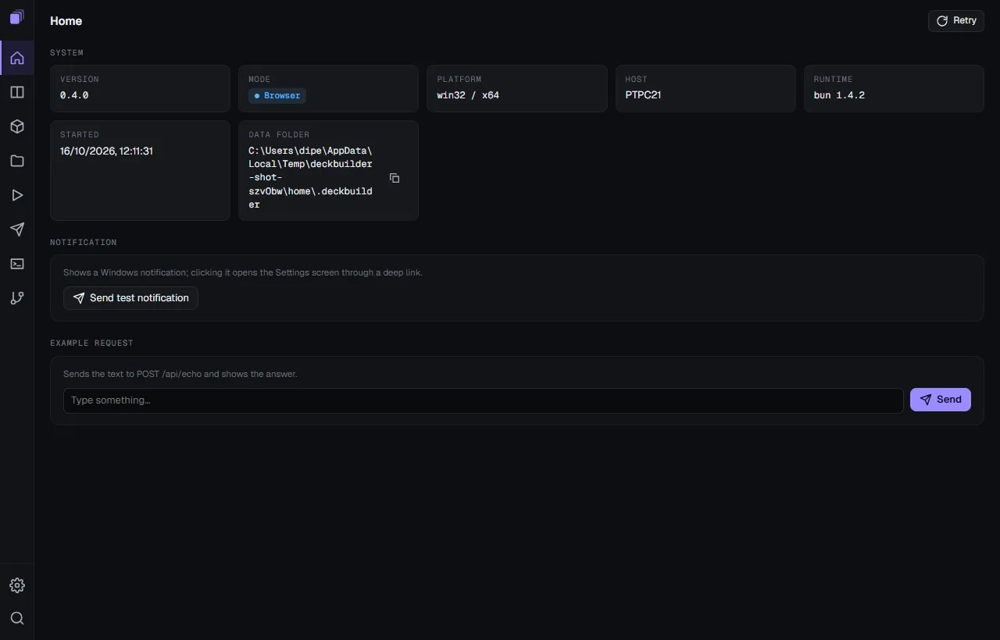<br>original</td>
<td align="center">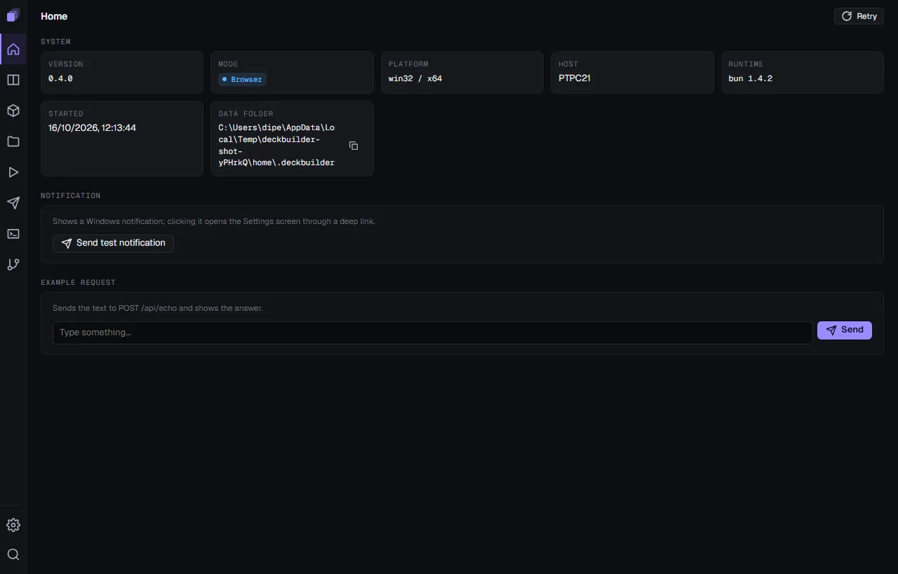<br>dense</td>
<td align="center">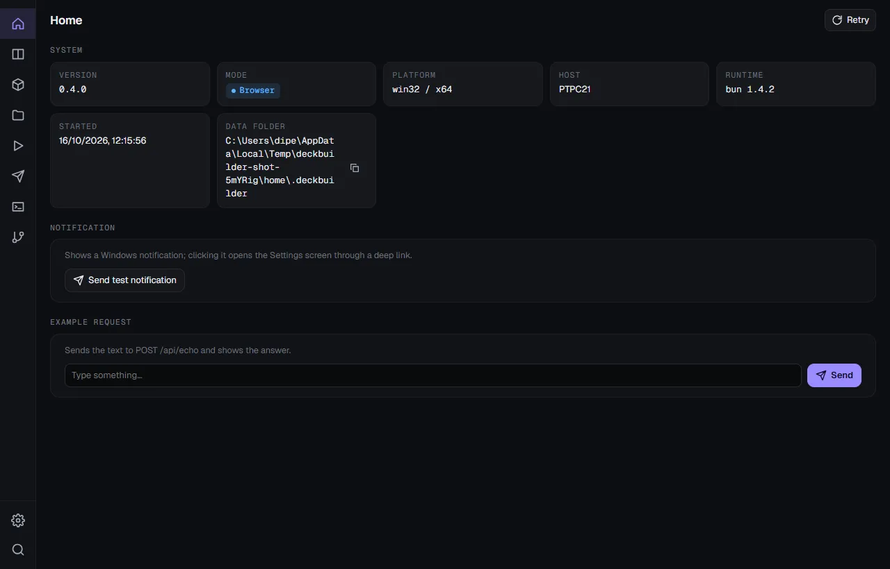<br>calm</td>
<td align="center">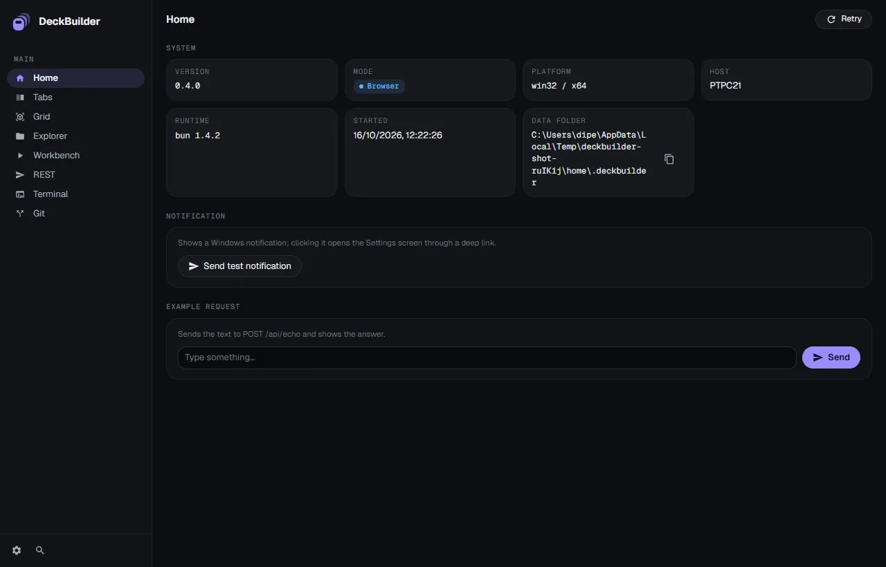<br>material</td>
</tr>
<tr>
<td align="center">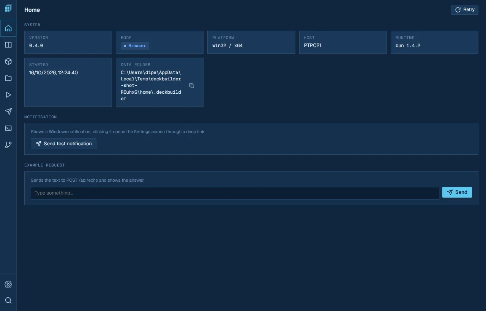<br>blueprint</td>
<td align="center">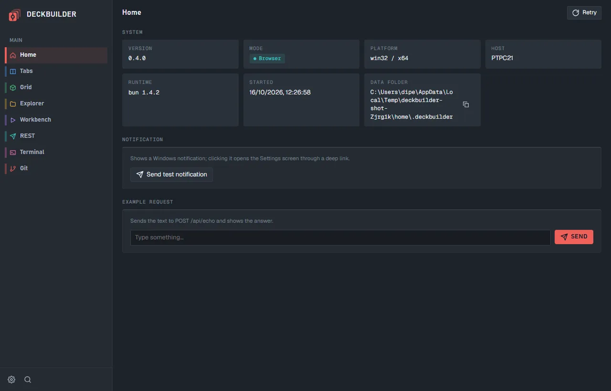<br>transit</td>
<td align="center">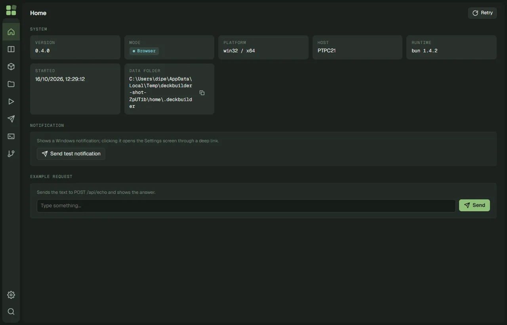<br>islands</td>
<td align="center">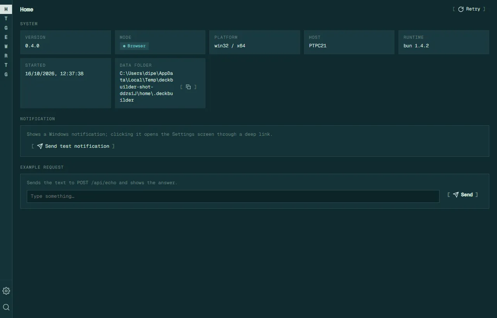<br>modeline</td>
</tr>
<tr>
<td align="center">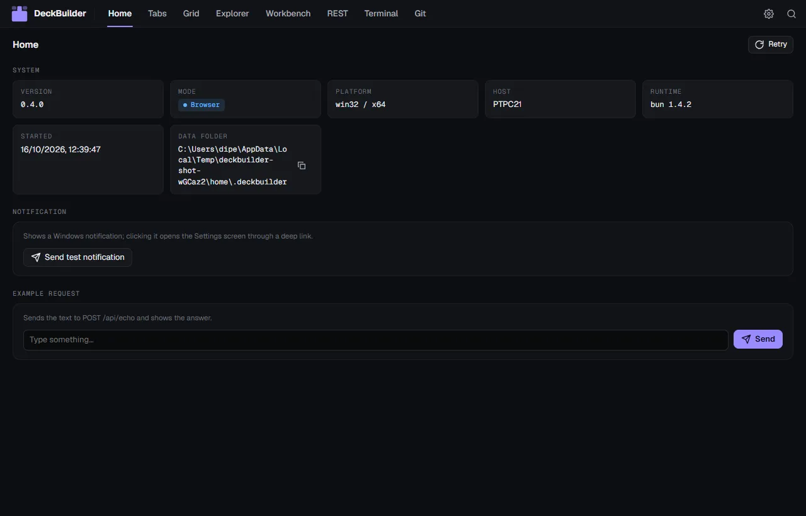<br>ribbon</td>
<td align="center">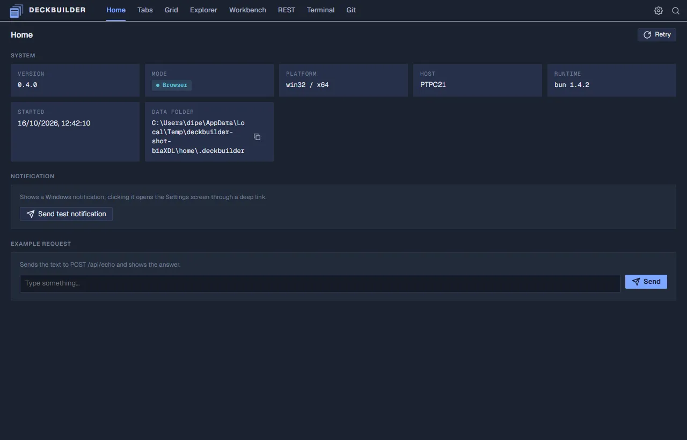<br>ledger</td>
<td align="center">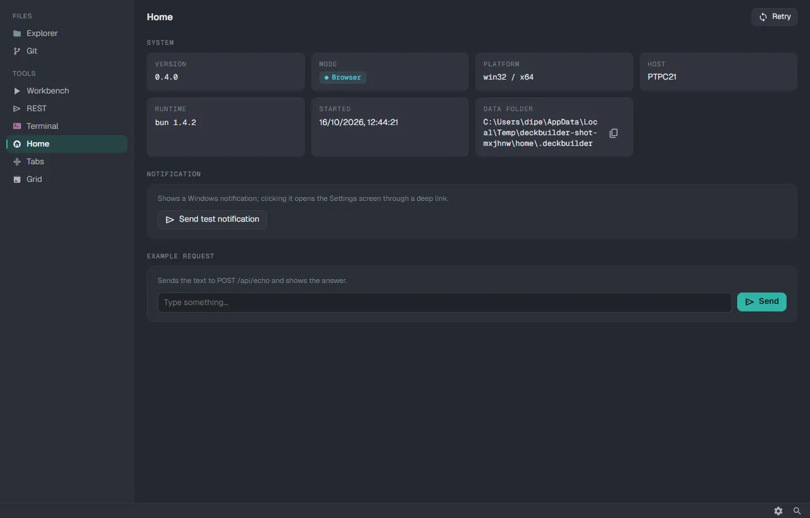<br>atlas</td>
<td></td>
</tr>
</table>

Under Settings > Appearance:

- **Dock position**: where the navigation sits.
- **Layout icon**: the icon shown for the layout.
- **Icons**: icon pack (original, material or atom).

## Known limitations

- No cross-platform system tray. The webview-bun shell has none; the tray is implemented for Windows only. See [docs/shell-decision.md](docs/shell-decision.md).

## Links

- [CONTRIBUTING.md](CONTRIBUTING.md): build, test and release.
- [LICENSE.md](LICENSE.md): MIT.
