<p align="center">
  
</p>

Kedalion is a local-first desktop app that builds to one self-contained executable. It opens on the Dashboard and has views for files, HTTP, SQL, terminals, git and Claude Code sessions.


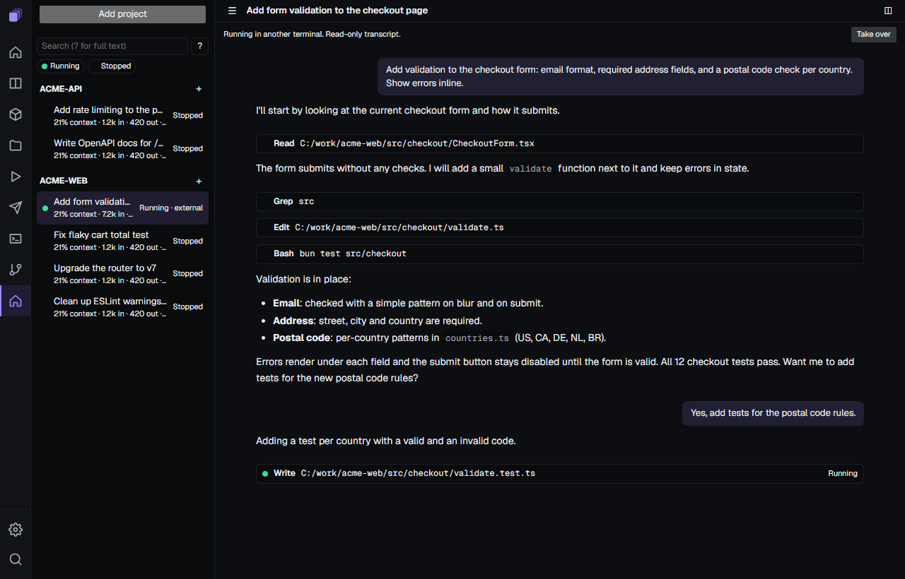

The Agents view (`view-agents`): Claude Code sessions per project, with live status, terminal/chat, usage and attention. Tool panels dock around the selected session: changes, diff, files, code, review, run, output, tasks, workflows, notes, preview, JSON, scratchpad, trajectory and usage. Skills opens as its own page.

- Projects are any picked folder. The sidebar is a tree of folders and tags. Sessions can be archived or moved to the trash; sort by manual, recent or needs attention.
- Each project shows at most `agents.maxSessionsPerProject` sessions (default 10); live sessions come first.
- A stopped session shows a card; `agents.resumeOnSelect` resumes it when selected, and `agents.restoreSessions` (ask, always, never) controls restoring sessions on start.
- Search accepts status prefixes `! @ # & ~`. Every list action is a palette command with a rebindable key.

## Download

Download the file for your system from the [releases](https://github.com/adrianogpena/kedalion/releases) (tag `kedalion-v<version>`) and run it:

| System | File |
| --- | --- |
| Windows x64 | `Kedalion-<ver>-win-x64.exe` |
| Linux x64, arm64 | `Kedalion-<ver>-linux-x64`, `Kedalion-<ver>-linux-arm64` |
| macOS Intel, Apple silicon | `Kedalion-<ver>-mac-x64`, `Kedalion-<ver>-mac-arm64` |

On Linux and macOS, make it executable first (`chmod +x Kedalion-*`). The executable opens a native window; `--app` opens an Edge/Chrome app window instead, `--browser` a browser tab, and `--port <n>` sets the port. Window mode needs the OS web view: WebView2 on Windows 10/11, WebKitGTK 6.0 on Linux (`sudo apt install libwebkitgtk-6.0-4` on Debian/Ubuntu).

Updates are signed: the app installs a new release only when its manifest signature verifies. Settings and data live in `~/.kedalion`.

## Run from source

Requires [Bun](https://bun.sh) 1.3 or newer.

```
git clone https://github.com/adrianogpena/kedalion.git
cd kedalion
bun install
bun run dev
```

Open the URL the server prints. `bun run build` builds the executable for this machine into `app/release/`; `bun run build --target all` builds it for every system. See [CONTRIBUTING.md](CONTRIBUTING.md) for the other scripts.

## Views

- **Dashboard**: the first view. Named layouts of configurable panels, with presets ("Save as preset", "My panels"). Panel areas: GitHub (pull requests, issues, Actions, notifications, releases), Jira (issues, counts, sprint board), calendar (month, sprint, countdowns, agenda from an ICS URL), feeds (weather, RSS, exchange rates) utilities (links, notes, URL health, JSON metric, system), and work tools: Tickets (Kanban board linked to PRs, pods and hours; optional GitHub connection), Tracked PRs (GitHub connection), Pods (needs `kubectl`; live logs, restart), Containers (needs `podman` or `docker`), Timesheet (hours from local Claude and Copilot sessions) and Meeting (daily checklist). Connections (GitHub, Jira) are stored server-side, never in the web app; GitHub falls back to the `gh` CLI login.
- **Explorer**: file browser with archives, git badges and file compare. Markdown opens in a rich editor with a toolbar, tables, highlighted code blocks, Mermaid diagrams, heading outline, followable links, zoom and reading width, and Export HTML; Source mode shows the raw text. Settings has a Markdown section. Keys include Ctrl+I, Ctrl+Shift+V (Source), Ctrl+Shift+O (go to heading), Ctrl+Alt+T (table); Ctrl+B stays the sidebar toggle outside the text.
- **Workbench**: SQL client (Oracle) with history, explain plan and table details. Explorer opens `.sql` files in it.
- **REST**: HTTP client with environments, history, and curl and `.http` import.
- **Terminal**: terminal with search and clipboard support.
- **Git**: repository status and history.
- **Agents**: Claude Code sessions, described above.
- **Settings**: theme, language, layout, browser and shortcuts.

Any view can pop out into its own window. All dialogs (file pickers, confirms) are in-app, themed and translated; no native OS dialogs.

## Layouts

Eleven layouts change how the app looks and where navigation sits. Details and more screenshots: [docs/LAYOUTS.md](docs/LAYOUTS.md).

<table>
<tr>
<td align="center">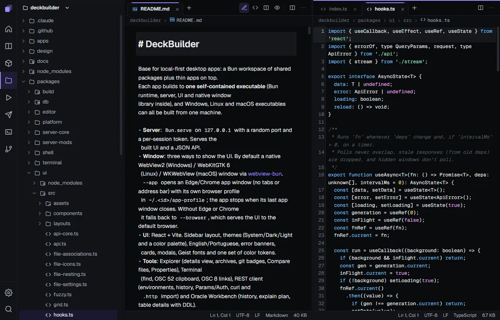<br>original</td>
<td align="center">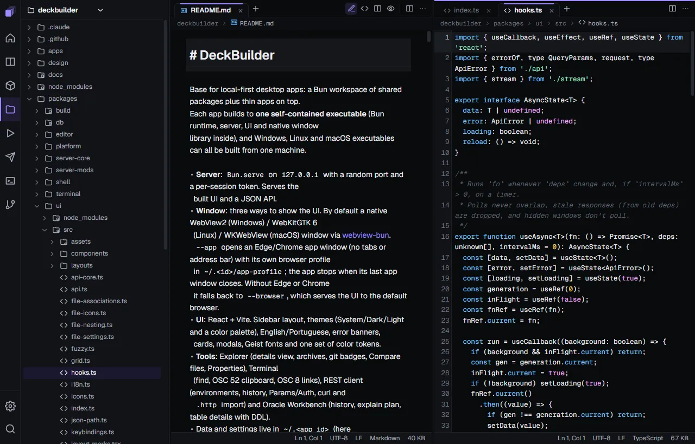<br>dense</td>
<td align="center">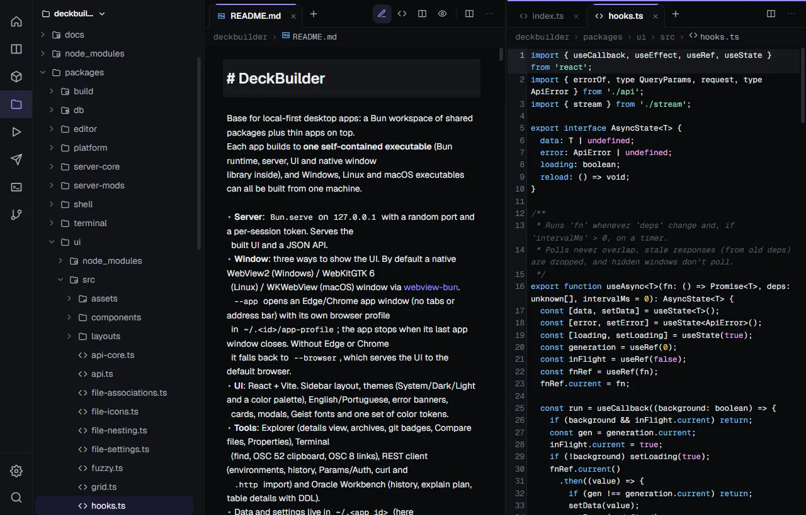<br>calm</td>
<td align="center">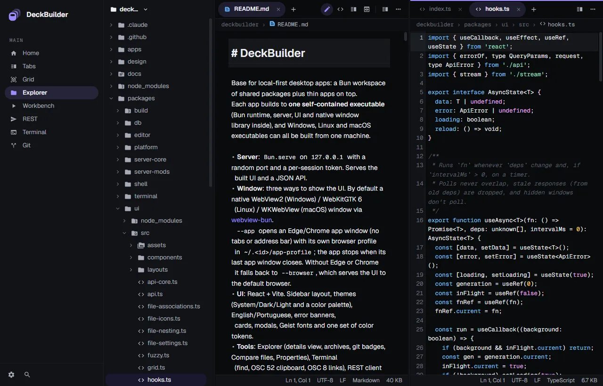<br>material</td>
</tr>
<tr>
<td align="center">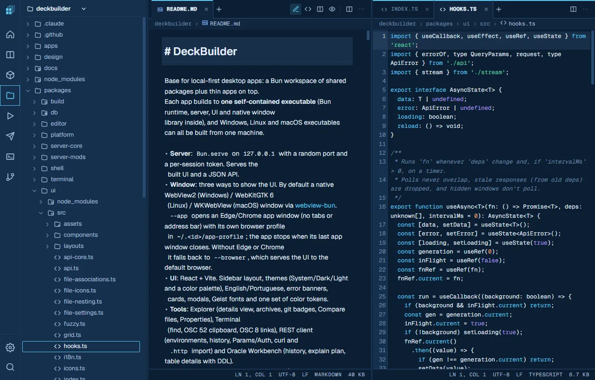<br>blueprint</td>
<td align="center">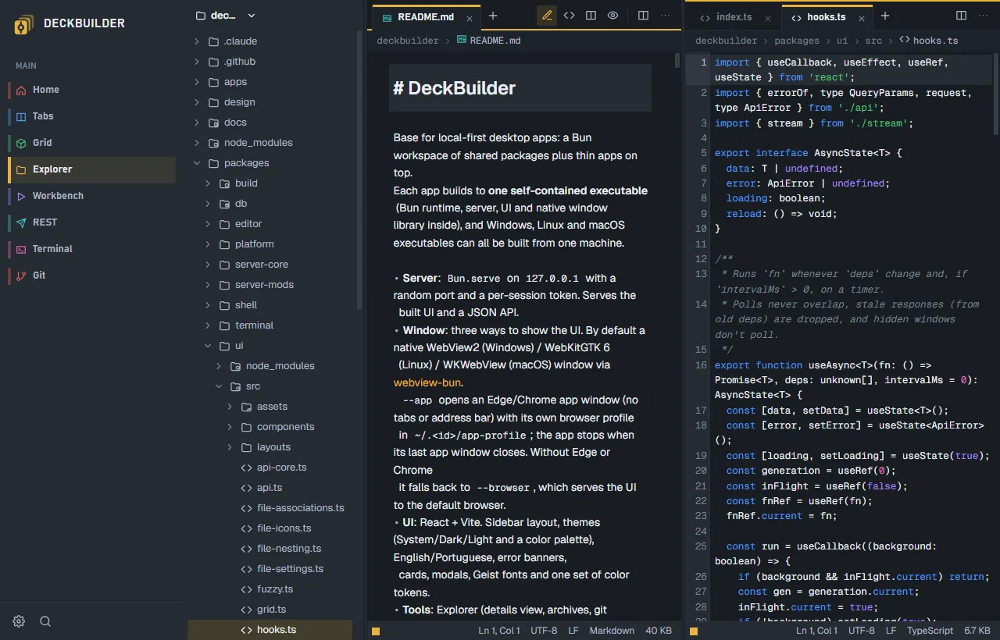<br>transit</td>
<td align="center">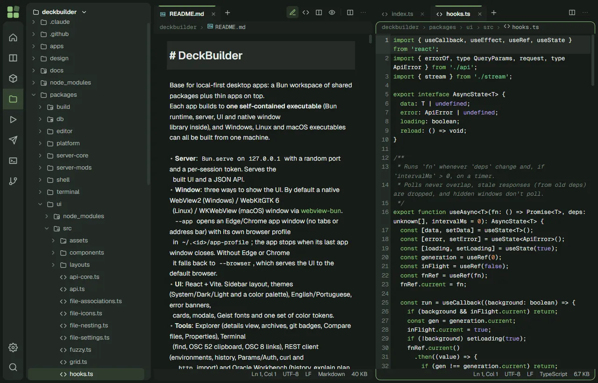<br>islands</td>
<td align="center">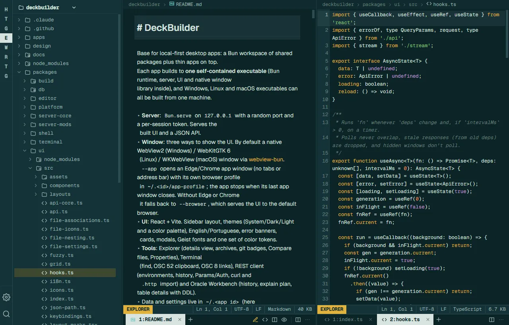<br>modeline</td>
</tr>
<tr>
<td align="center">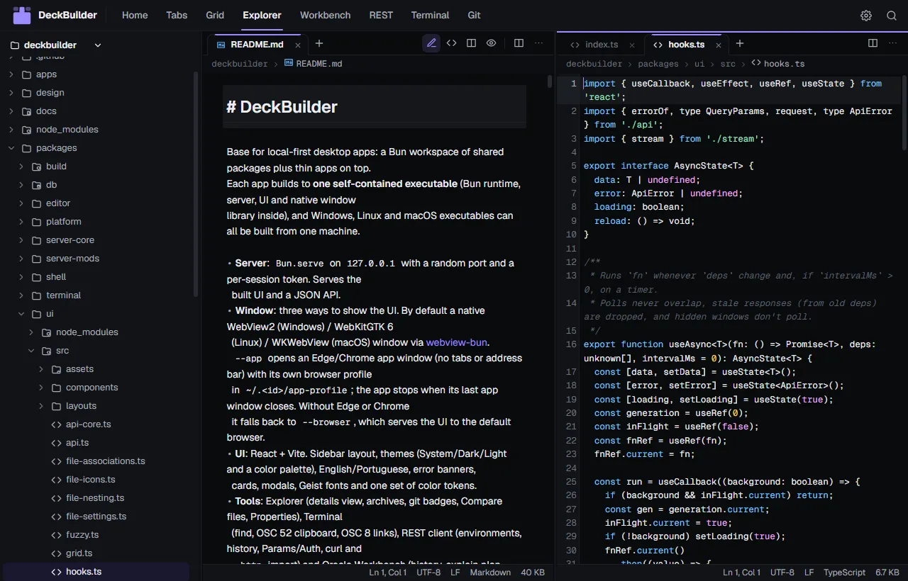<br>ribbon</td>
<td align="center">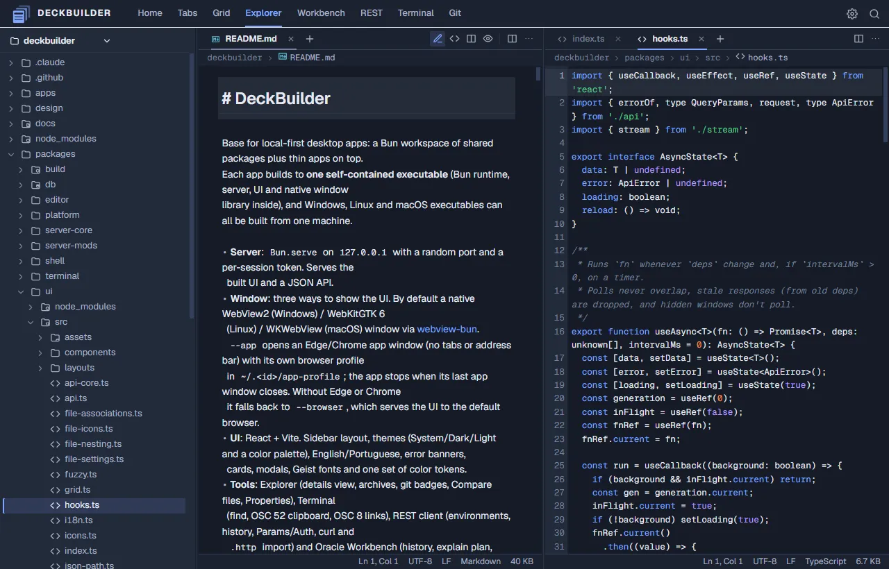<br>ledger</td>
<td align="center">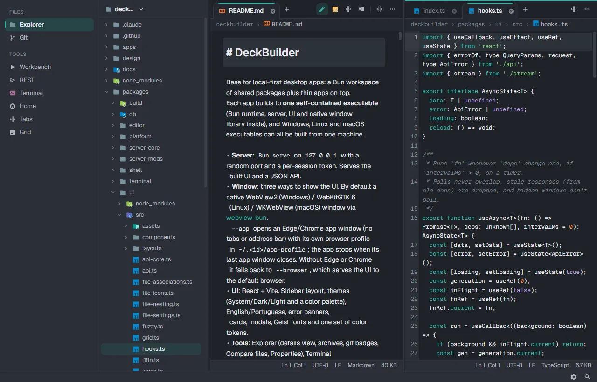<br>atlas</td>
<td></td>
</tr>
</table>

Under Settings > Appearance:

- **Dock position**: where the navigation sits.
- **Layout icon**: the icon shown for the layout.
- **Icons**: icon pack (original, material or atom).

## Known limitations

- No cross-platform system tray. The webview-bun shell has none; the tray is implemented for Windows only. See [docs/shell-decision.md](docs/shell-decision.md).

## Links

- [CONTRIBUTING.md](CONTRIBUTING.md): build, test and release.
- [LICENSE.md](LICENSE.md): MIT.
